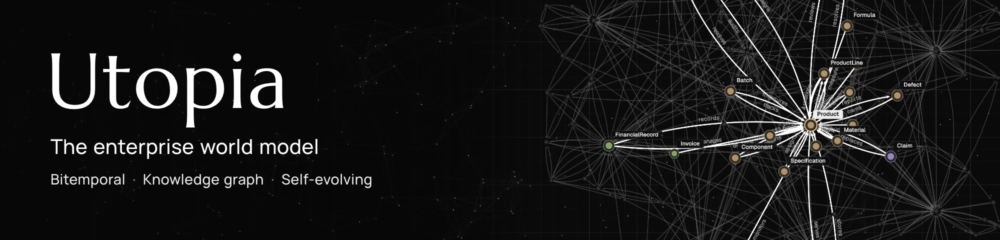

<div align="center">



# Soorin Temporal Knowledge Graph

**Temporal security intelligence · Provenance-aware knowledge · Hybrid graph retrieval**

An independent knowledge service for security entities, evidence, relationships,
and historical state, built on Utopia and designed for future Agentic SOC use.

[Architecture](docs/soorin/SOC_KNOWLEDGE_ARCHITECTURE.md) · [Local development](docs/soorin/LOCAL_DEVELOPMENT.md) · [E2E validation](docs/soorin/LOCAL_E2E_VALIDATION.md) · [Engineering docs](docs/soorin/README.md)

</div>

> [!IMPORTANT]
> **Engineering handoff; production release is not approved.** Native SOC ingestion,
> identity, temporal context and model transport are implemented. See the
> [acceptance report](docs/soorin/FINAL_ACCEPTANCE_REPORT.md) for exact evidence,
> deferred builds/inference, and remaining runtime gates.

## What Soorin implements

Soorin turns curated security observations into tenant-scoped, evidence-backed
knowledge with valid-time and knowledge-time history. It is an independent Rust
API, React UI and PostgreSQL/pgvector service built on Utopia; Agentic_SOC and AI
model services are optional integrations.

- Canonical event v1 and checksum v3, source minimization, conservative scoped
  identities, 17 SOC entity types and 15 reviewed relation types.
- Native source-token admission, durable receipts/jobs, active PostgreSQL identity
  registry, conflicts/aliases, deterministic alignment and typed materialization.
- Bitemporal graph and attachment-time-aware evidence; bounded authorized
  KnowledgeContext v2 with explicit truncation and exact extractive citations.
- Tantivy/pgvector/RRF retrieval, model fingerprints, guarded embedding writes,
  explicit backfill and optional native batched reranking.
- Pinned optional CPU embedding/reranker/NER services with separate download,
  artifact verification and offline serving. NER proposals require review.
- Deployment-owned model origins and native Privacy Gateway transport, including
  tool/stream handling and redacted errors; live gateway acceptance remains pending.
- A bounded authenticated native SOC client and read-only agent contract; no
  automated containment or deployed Agentic_SOC write-back.

```text
Curated source → normalization / event v1 → authenticated native receipt
  → scoped identity registry → Statements pipeline → exact SOC alignment
  → typed temporal graph → authorized retrieval / KnowledgeContext → SOC consumers
```

## Start safely

Use [lightweight checks](docs/soorin/PREBUILD_VALIDATION.md),
[local development](docs/soorin/LOCAL_DEVELOPMENT.md), and the
[controlled build handoff](docs/soorin/BUILD_AND_TEST_HANDOFF.md).
Existing labs may occupy 1516/1517 and 2516/2517; inventory before startup and
preserve their KBs/data. Mock tests do not prove real model or runtime readiness.

Production uses [the independent deployment path](docs/soorin/PRODUCTION_DEPLOYMENT.md)
with `docker-compose.production.yml` and
`soorin/config/production.env.example`. It requires an explicitly qualified Soorin
image; generic upstream-image Compose is not the Soorin production entry point.
No published production image is assumed.

Model settings belong to authenticated workspaces; Python evaluation variables
do not activate native clients. See [model configuration](docs/soorin/MODEL_CONFIGURATION.md),
[artifact lifecycle](docs/soorin/MODEL_ARTIFACT_MANAGEMENT.md),
[security](docs/soorin/SECURITY_BOUNDARIES.md), and
[Agentic_SOC integration](docs/soorin/AGENTIC_SOC_INTEGRATION_V1.md).

The current Soorin schema must not be merged directly with upstream migration
0111. Applied SQL is immutable; use the reviewed
[roll-forward reconciliation plan](docs/soorin/upstream-sync.md).

The [documentation index](docs/soorin/README.md) distinguishes current contracts
and acceptance evidence from historical Sprint 1 reports.

## License and attribution

The Utopia-derived implementation is distributed under the bundled
[Apache-2.0 license](LICENSE). Preserve upstream copyright and license notices.
The original documentation remains in [README.upstream.md](README.upstream.md).

---

<div align="center">

**Soorin Temporal Knowledge Graph** · Security knowledge with identity, evidence, and time.

</div>
