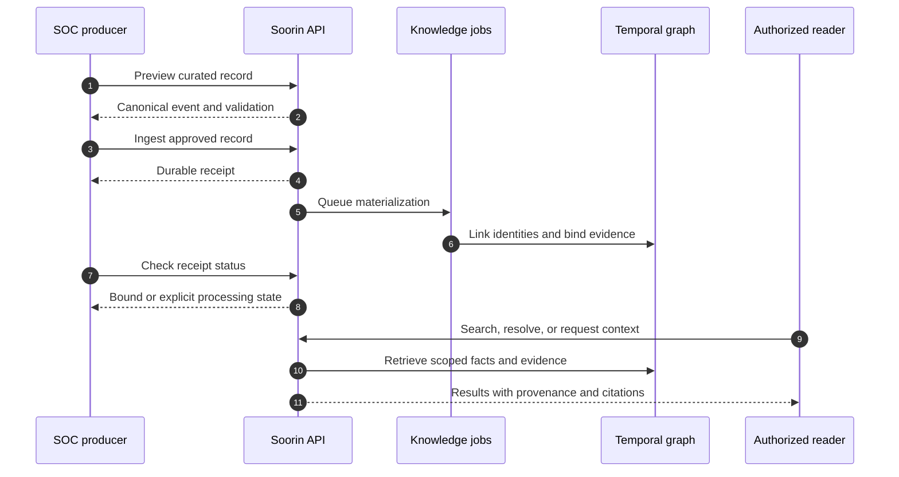

# Soorin Temporal Knowledge Graph

**A temporal, evidence-grounded knowledge layer for security operations and AI agents.**

Connect security alerts, identities, assets, investigations, and evidence in a consistent knowledge graph. Explore what happened, how entities are related, and what was known at any point in time.

[**Architecture**](docs/soorin/PRODUCTION_ARCHITECTURE.md) · [**API & ingestion**](docs/soorin/MANUAL_SOC_INGESTION.md) · [**Search & GraphRAG**](docs/soorin/RETRIEVAL_AND_RERANKING.md) · [**Integrations**](docs/soorin/AGENTIC_SOC_INTEGRATION_V1.md) · [**Documentation**](docs/soorin/README.md)

## Overview

Security knowledge rarely lives in one place. SIEM events, notable alerts, investigation records, infrastructure inventories, and analyst findings contain related facts but use different identifiers, timestamps, and evidence formats.

**Soorin TKG** provides an independent knowledge service for bringing these records together without losing their source authority or history. Its provenance-first design distinguishes an exact identity match from a relevant search result, and an evidence-backed fact from a generated interpretation.

Built on the [Utopia graph foundation](README.upstream.md), Soorin adds SOC-oriented data contracts, a reviewed security ontology, deterministic normalization, durable identity resolution, bitemporal knowledge, and agent-accessible retrieval.

## Core capabilities

| Capability | What it enables |
|---|---|
| **Canonical security identities** | Resolve and link alerts, hosts, IP addresses, users, detections, cases, and other entities through governed source authority rather than name similarity alone. |
| **Temporal knowledge** | Reconstruct valid-time and knowledge-time perspectives across evolving observations, corrections, and investigations. |
| **Evidence-backed relationships** | Preserve typed facts, source-document versions, provenance, and citations for traceable reasoning. |
| **SOC event ingestion** | Preview and ingest supported curated or canonical security records with durable receipts and asynchronous materialization. |
| **Hybrid retrieval** | Combine exact identity resolution, Tantivy BM25, pgvector-based semantic recall, and optional relevance reranking. |
| **Agent and application access** | Expose scoped knowledge through REST APIs, MCP tools, and the React operator interface. |
| **Governed AI assistance** | Use local CPU embedding and reranking services, review-only entity proposals, and explicit privacy controls for external model calls. |

The [SOC ontology](docs/soorin/SOC_ONTOLOGY.md) defines security-focused entity types, relationships, and constraints. Knowledge bases, source bindings, and access controls keep the data lifecycle explicit.

## System architecture

```mermaid
flowchart LR
    subgraph Sources["Security sources"]
        SIEM["SIEM alerts and events"]
        PROD["Curated SOC producers"]
    end

    subgraph Intake["Governed ingestion"]
        PRE["Preview and normalize"]
        AUTH["Source authentication"]
        REC["Durable receipts"]
    end

    subgraph Knowledge["Temporal knowledge engine"]
        ID["Canonical identity"]
        FACT["Typed facts and evidence"]
        TIME["Bitemporal history"]
    end

    subgraph Storage["Knowledge persistence"]
        DB[("PostgreSQL and pgvector")]
        BM[("Tantivy search index")]
    end

    subgraph Access["Knowledge access"]
        RES["Exact resolution"]
        SEARCH["Hybrid search"]
        CTX["Knowledge context"]
    end

    subgraph Consumers["Authorized consumers"]
        REST["REST and MCP"]
        UI["Operator UI"]
        AGENT["SOC agent integrations"]
    end

    SIEM --> PRE
    PROD --> PRE
    PRE --> AUTH --> REC --> ID --> FACT --> TIME
    TIME --> DB
    FACT --> BM
    DB --> RES
    DB --> SEARCH
    DB --> CTX
    BM --> SEARCH
    RES --> REST
    SEARCH --> REST
    CTX --> REST
    REST --> UI
    REST -.-> AGENT

    MODELS["Optional CPU models"] -.-> SEARCH

    classDef source fill:#eff6ff,stroke:#407eb4,color:#173a60
    classDef core fill:#eaf7f0,stroke:#2c805b,color:#174b37
    classDef store fill:#f2efff,stroke:#7767ad,color:#362964
    classDef client fill:#fff4e8,stroke:#bb853d,color:#604116
    class SIEM,PROD source
    class AUTH,REC,ID,FACT,TIME core
    class DB,BM store
    class UI,AGENT,REST client
```

The knowledge ledger in **PostgreSQL** is authoritative. **Tantivy** is a rebuildable lexical index; **pgvector** supports semantic retrieval. Search relevance does not establish identity authority, and external agents are consumers of evidence rather than owners of the knowledge graph.

For component responsibilities, deployment boundaries, and source-level design, see [Production Architecture](docs/soorin/PRODUCTION_ARCHITECTURE.md) and [Knowledge Architecture](docs/soorin/SOC_KNOWLEDGE_ARCHITECTURE.md).

## From an alert to grounded knowledge

Ingestion is asynchronous: a receipt confirms that a record has been accepted for processing; a **bound** receipt confirms that the expected materialization checks have completed. Search, exact identity resolution, and temporal context serve distinct purposes.

For the complete event envelopes, authentication rules, response schemas, retries, and error handling, consult the [Ingestion Guide](docs/soorin/MANUAL_SOC_INGESTION.md), [Curated HTTP Contract](soorin/contracts/schemas/curated_http_v1.openapi.json), and [Identity Resolution](docs/soorin/ENTITY_RESOLUTION.md).

## Integration surfaces

The following are selected endpoints; paths are relative to `/api/v1`.

| Workflow | Endpoint |
|---|---|
| Preview a curated SOC alert | `POST /sources/{source_id}/soc/preview` |
| Submit a curated SOC alert | `POST /sources/{source_id}/soc/ingest` |
| Submit a canonical SOC event | `POST /sources/{source_id}/knowledge-events` |
| Check ingestion progress | `GET /kbs/{kb_id}/knowledge/receipts/{receipt_id}` |
| Resolve a source-backed identity | `POST /kbs/{kb_id}/knowledge/resolve` |
| Search indexed knowledge | `POST /kbs/{kb_id}/search` |
| Retrieve graph facts and evidence | `POST /kbs/{kb_id}/knowledge/context` |
| Inspect the knowledge graph | `GET /kbs/{kb_id}/graph/overview` |
| Access knowledge tools | `POST /kbs/{kb_id}/mcp` |

Curated SOC ingestion uses a documented versioned source profile; it is not a generic, schema-free JSON endpoint. Read and write clients use different scoped credentials. Retrieval metadata identifies which lexical, dense, and reranking stages were actually executed.

Soorin TKG is independently deployable. **Agentic_SOC** and other investigation systems can integrate as event producers and evidence consumers through these interfaces without sharing the graph database directly.

See [Producer Mapping](docs/soorin/PRODUCER_MAPPING_V1_20261115.md), [Agentic_SOC Integration](docs/soorin/AGENTIC_SOC_INTEGRATION_V1.md), [Agent Tool Contracts](docs/soorin/AGENT_TOOL_CONTRACTS.md), and [Retrieval & Reranking](docs/soorin/RETRIEVAL_AND_RERANKING.md).

## Deploy and operate

The repository separates application, model-runtime, and database concerns and provides distinct configurations for development and controlled deployment. Model artifacts, secrets, persistent volumes, and service access are managed outside the source tree.

Start with [Local Development](docs/soorin/LOCAL_DEVELOPMENT.md) for an engineering environment or [Deployment & Operations](docs/soorin/PRODUCTION_DEPLOYMENT.md) for the documented deployment, configuration, security, backup, and recovery requirements.

## Documentation

| Topic | Reference |
|---|---|
| **Architecture and design** | [Production Architecture](docs/soorin/PRODUCTION_ARCHITECTURE.md) · [Knowledge Architecture](docs/soorin/SOC_KNOWLEDGE_ARCHITECTURE.md) |
| **Ingestion and API contracts** | [Manual SOC Ingestion](docs/soorin/MANUAL_SOC_INGESTION.md) · [OpenAPI Schema](soorin/contracts/schemas/curated_http_v1.openapi.json) |
| **Identity and temporal semantics** | [Identity Resolution](docs/soorin/ENTITY_RESOLUTION.md) · [Temporal Model](docs/soorin/TEMPORAL_MODEL.md) · [SOC Ontology](docs/soorin/SOC_ONTOLOGY.md) |
| **Search and agent tools** | [Retrieval & Reranking](docs/soorin/RETRIEVAL_AND_RERANKING.md) · [Agent Tool Contracts](docs/soorin/AGENT_TOOL_CONTRACTS.md) |
| **Integrations** | [Agentic_SOC](docs/soorin/AGENTIC_SOC_INTEGRATION_V1.md) · [Source Mapping](docs/soorin/PRODUCER_MAPPING_V1_20261115.md) |
| **Models, security, and operations** | [Model Configuration](docs/soorin/MODEL_CONFIGURATION.md) · [Security Boundaries](docs/soorin/SECURITY_BOUNDARIES.md) · [Deployment](docs/soorin/PRODUCTION_DEPLOYMENT.md) |
| **Engineering validation** | [Testing & Evaluation](docs/soorin/TESTING_AND_EVALUATION.md) · [Engineering Documentation Index](docs/soorin/README.md) |

## License and acknowledgments

Licensed under [Apache-2.0](LICENSE). Soorin TKG builds on the [Utopia](README.upstream.md) project; the original notices and upstream documentation are preserved.
