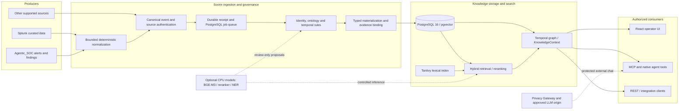
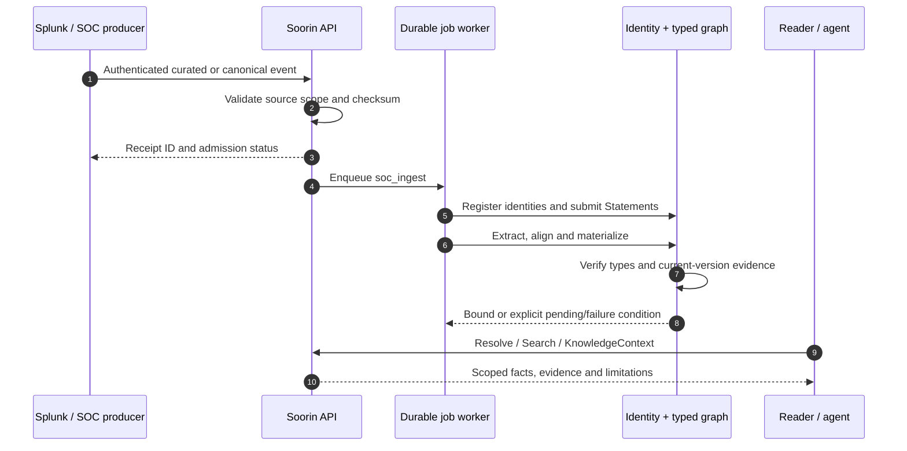

<div align="center">


# Soorin Temporal Knowledge Graph

**A provenance-first, temporal knowledge layer for security operations and AI agents.**

Connect alerts, identities, infrastructure, investigations and evidence into an auditable graph, while retaining both **when a fact was valid** and **when it became known**.

[](https://github.com/alirzx/Soorin_Bidirectional_Temporal_Knowledge_Graph/actions/workflows/checks.yml)
[](LICENSE)


[Architecture](docs/soorin/PRODUCTION_ARCHITECTURE.md) · [API and ingestion](docs/soorin/MANUAL_SOC_INGESTION.md) · [Search and GraphRAG](docs/soorin/RETRIEVAL_AND_RERANKING.md) · [Deployment](docs/soorin/PRODUCTION_DEPLOYMENT.md) · [Documentation](docs/soorin/README.md)

</div>

> **Release status:** The source-hardening and automated CI phase has passed. The exact rebuilt application image, an empty local PostgreSQL environment, real CPU-model inference and the complete SOC/agent integration sequence have **not yet been runtime-qualified**. This repository is **ready for the next controlled local build**, not an approved production release. See the [latest engineering report](docs/soorin/CONTINUATION_HARDENING_REPORT.md), [19-task acceptance matrix](docs/soorin/CONTINUATION_TASK_MATRIX.md) and [next build plan](docs/soorin/NEXT_APPROVED_BUILD_20261115.md). A green CI badge is not a substitute for deployment evidence.

## The product

Security knowledge is fragmented across SIEM events, alerts, asset inventories, investigations and analyst decisions. A search hit is not an identity claim; an LLM response is not evidence; and the latest state is not the whole history.

**Soorin TKG** provides an independently deployable knowledge service designed to preserve those distinctions. It builds on the [Utopia](README.upstream.md) Rust/PostgreSQL graph foundation and adds SOC-specific contracts, durable source authority, typed evidence, temporal processing and governed retrieval.

| Operational need | Soorin capability | Boundary |
|---|---|---|
| Trustworthy identities | Canonical identity registry, aliases, provenance, conflict quarantine and immutable KB source bindings | Similar names and embedding matches never authorize merges |
| Traceable investigations | Reviewed ontology, typed relations, source-document versions and evidence links | Receipt acceptance is not graph completion |
| Historical answers | Valid-time and knowledge-time graph access with bounded citations | Historical evidence must have been available at the requested time |
| Search across disparate records | Tantivy BM25, compatible pgvector recall, rank fusion and optional reranking | Retrieval relevance must be measured on real evaluation data |
| Agent-ready knowledge | KnowledgeContext v2, authenticated MCP and native graph-aware tools | Read access grants no containment or response authority |
| Private model operations | Optional pinned CPU services, explicit provider configuration and Privacy Gateway policy | External-provider acceptance and image deployment remain separate gates |

### Product scope

The reviewed SOC ontology currently defines **17 entity types** and **15 relation types**, including alerts, notables, source events, infrastructure identities, detections, cases and evidence. Its declared constraints, runtime-supported axioms and policy-only fields are distinguished in the [ontology specification](docs/soorin/SOC_ONTOLOGY.md). The ontology is reviewed, not automatically expanded from model suggestions.

Soorin runs as a **standalone service** with its own users, workspaces, knowledge bases, PostgreSQL database, jobs, UI and API. [Agentic_SOC](docs/soorin/AGENTIC_SOC_INTEGRATION_V1.md) is a supported integration target, not a mandatory runtime dependency.

## Architecture



The PostgreSQL database is authoritative. Tantivy is a rebuildable lexical index, not an alternative source of truth. The Python SOC normalizer is deterministic; graph extraction and Utopia's existing alignment/materialization pipeline run behind the Rust API.

| Component | Implementation | Responsibility |
|---|---|---|
| API, background processing and graph | Rust / Axum | Authentication, source ingestion, job processing, temporal graph, retrieval and operator endpoints |
| Durable state and vectors | PostgreSQL 16 / pgvector | Identities, document versions, typed facts, evidence, jobs, time history and vector metadata |
| Lexical retrieval | Tantivy | Current-record BM25 recall |
| Contracts and adapters | Python | Curated Splunk/Agentic_SOC normalization and canonical v1 events |
| Optional model runtime | Python, CPU-only | Pinned BGE-M3 embeddings, BGE reranking and review-only cybersecurity NER |
| Operator application | React / TypeScript | Graph, Search, Ask, Library, Review, Ontology, Mappings and Settings |
| Agent and integration surfaces | REST / MCP | Scoped retrieval, citations, temporal context and native tools |

[Verified source call paths](docs/soorin/CONTINUATION_ARCHITECTURE.md) · [Production architecture](docs/soorin/PRODUCTION_ARCHITECTURE.md)

## From security event to evidence-backed graph



Admission and graph readiness are separate. A successful `/soc/ingest` or `/knowledge-events` response supplies a **durable receipt**, not a guarantee that every node, relation or embedding already exists. The `bound` state is gated on the document, expected typed entities, authority links and current-version relation evidence. Temporary dependencies use bounded Deferred retries; terminal conflicts and human rejections are not silently bypassed.

### Ingestion contracts

There are **two supported SOC ingestion entry points**:

1. **Curated source record:** `POST /api/v1/sources/{id}/soc/preview` or `/soc/ingest`, with `{"profile":"agentic-soc.splunk-curated.v1","record":{...}}`. The Rust API authenticates the source and supplies the immutable tenant/source scope. A bounded Python subprocess reuses the same canonical normalizer. Preview does not persist data.
2. **Already canonical event:** `POST /api/v1/sources/{id}/knowledge-events` with a validated `soorin.soc.knowledge-event.v1` payload and checksum v3. A dedicated **Statements** source with a matching KB binding and its own ingest token is required.

The pre-existing Statements push endpoint is available separately for supported Utopia statements; it is **not** a substitute for the native SOC receipt lifecycle. Raw arbitrary vendor schemas, batch envelopes and implied identity authority are not accepted by the curated v1 profile.

## API surface

Paths below are relative to `/api/v1`. The API enforces different credentials for source ingestion and KB reading.

| Workflow | Method and path | Contract / key result |
|---|---|---|
| Preview SOC record | `POST /sources/{id}/soc/preview` | Source bearer token; canonical event and normalization diagnostics, no durable write |
| Submit curated SOC record | `POST /sources/{id}/soc/ingest` | Source bearer token; native receipt and job |
| Submit canonical SOC event | `POST /sources/{id}/knowledge-events` | Source bearer token; checksum/idempotent receipt |
| Inspect ingestion | `GET /kbs/{kb}/knowledge/receipts` | Authorized KB operator; bounded receipt/job statuses |
| Diagnose a receipt | `GET /kbs/{kb}/knowledge/receipts/{receipt}` | KB administration; expected edges, binding, document version and evidence status |
| Retry a repaired receipt | `POST /kbs/{kb}/knowledge/receipts/{receipt}/retry` | Scoped administrative recovery; not a mass requeue |
| Resolve exact source identity | `POST /kbs/{kb}/knowledge/resolve` | Tenant, source authority, entity type and source identifier; `resolved` / `pending_materialization` / other explicit status |
| Search indexed text | `POST /kbs/{kb}/search` | `q`, optional `top_k` and `as_of`; result chunks and retrieval metadata |
| Retrieve temporal graph context | `POST /kbs/{kb}/knowledge/context` | `tenant_id`, `entity`, optional `entity_type`, `at`, `as_of`, `limit` |
| Inspect current graph | `GET /kbs/{kb}/graph/overview` | Scoped nodes and typed edges |
| Use MCP tools | `POST /kbs/{kb}/mcp` | Scoped PAT and JSON-RPC; eleven read tools for read-only credentials |
| Native chat / tools | `POST /kbs/{kb}/chat` | Workspace-configured model and existing authorization/privacy controls |

**Search semantics:** `/knowledge/resolve` is **exact identity authority resolution**, not fuzzy search. `/search` is the production **lexical + optional dense hybrid** endpoint: current lexical recall uses Tantivy BM25; compatible pgvector candidates are fused using reciprocal rank fusion and may be reranked. Historical `as_of` recall uses versioned PostgreSQL lexical search, **not** historical BM25. The current Search request does **not** expose an independent `mode=lexical|semantic` selector. Inspect `retrieval.dense_executed`, `retrieval.lexical_method` and `retrieval.reranker_status`; a nonempty result does not demonstrate that dense inference ran.

```json
{
  "q": "synthetic authentication anomaly",
  "top_k": 10
}
```

Detailed contracts: [Curated HTTP OpenAPI](soorin/contracts/schemas/curated_http_v1.openapi.json) · [Manual ingestion](docs/soorin/MANUAL_SOC_INGESTION.md) · [Exact identity](docs/soorin/ENTITY_RESOLUTION.md) · [Retrieval and reranking](docs/soorin/RETRIEVAL_AND_RERANKING.md) · [MCP and tools](docs/soorin/AGENT_TOOL_CONTRACTS.md).

## Identity, evidence and time

A SOC Alert, Splunk Notable, raw security event, detection rule and investigation case can refer to the same incident without becoming the same identity. Source authority and tenant/source/network scope govern canonical linking; unresolved conflicts are recorded for review.

The temporal graph distinguishes:

- **Valid time (`at`)**: when a fact was true in the modeled world.
- **Knowledge time (`as_of`)**: when the system had the fact/evidence available.

Historical context requires a resolved entity UUID, not a current fuzzy name; legacy evidence without a trustworthy attachment time is not invented for historical queries. Facts and evidence can have partial or contested status. Extractive grounding validates ledger-backed claims, **not** every conclusion an external LLM might generate.

[Identity resolution](docs/soorin/ENTITY_RESOLUTION.md) · [Temporal model](docs/soorin/TEMPORAL_MODEL.md) · [SOC ontology](docs/soorin/SOC_ONTOLOGY.md).

## Model and privacy boundaries

| Role | Model / behavior | Deployment condition |
|---|---|---|
| Embedding | Pinned BGE-M3, 1024-dimensional vectors | Optional local CPU service; batching/window limits and revision lineage |
| Reranking | Pinned BGE reranker v2-M3 | Optional, candidate-bounded and separately reported |
| Entity proposals | Cybersecurity NER | **Review-only** suggestions; no automatic identity authority |
| External chat/agent provider | Operator-configured OpenAI-compatible endpoint, including supported DeepSeek deployment | Explicit model, credential, approved origin and Privacy Gateway controls |

The current optional model overlay starts **one CPU container with three listeners** and separate read-only cache volumes. All three model snapshots must be verified before that combined service can start. The QA template reserves up to 7 GiB for this container and requires actual peak-memory qualification.

Raw SIEM payloads and sensitive excerpts are minimized by policy. Structural minimization is not a substitute for the standalone Privacy Gateway. Protected external calls have separate Gateway timeouts, tenant mapping and fail-closed behavior; direct-provider fallback is not an authorized recovery path. Soorin does **not** perform automated containment or SOAR write-back.

[CPU model configuration](docs/soorin/MODEL_CONFIGURATION.md) · [Artifact integrity and cache lifecycle](docs/soorin/MODEL_ARTIFACT_MANAGEMENT.md) · [Outbound privacy](docs/soorin/OUTBOUND_PRIVACY.md) · [Security boundaries](docs/soorin/SECURITY_BOUNDARIES.md).

## Build and operate in an isolated environment

The existing QA stack was inspected on 2026-11-15: it uses **`.env`**, project
`soorin-tkg-v1-qa` and the original app/DB volumes. For its next upgrade use the
[backup-first app-only rebuild](docs/soorin/APP_ONLY_REBUILD_20261115.md) with
`QA_ENV_FILE=.env`; preserve the historical KB and test ingestion in new synthetic
KBs. The [final source report](docs/soorin/FINAL_SOURCE_HARDENING_20261115.md)
records identity, index-recovery, title-recall and acceptance-harness corrections.
The fresh-stack commands below apply only to genuinely new environments.

The codebase is prepared for a **controlled local qualification build**, not a blanket reset of previous laboratories. The source-development Compose, production Compose and legacy upstream-compatible Compose serve different purposes. Never use a generic `docker compose down -v` or prune as an upgrade procedure.

```bash
# Read-only preflight in the local checkout:
git status --short --branch
git rev-parse HEAD
docker ps --format 'table {{.Names}}\t{{.Status}}\t{{.Ports}}'
docker volume ls
docker compose --env-file soorin/config/qa.env.example -p soorin-tkg-v1-qa \
  -f docker-compose.soorin-dev.yml config --quiet
```

After confirming that the target QA project, ports and **both named data volumes** are new/disposable, the documented Makefile provides `make qa-env-init`, `make qa-config`, `make qa-build`, `make qa-up QA_EXECUTE=YES` and `make qa-native-e2e`. These are **opt-in commands** for the next approved execution phase, not commands the present source review ran.

**Fresh-state warning:** The native E2E safety guard currently permits the specifically named project `soorin-tkg-v1-qa` and validates its mounts and loopback ports. If that project's old volumes already exist, do **not** reinitialize or erase them. Provision a genuinely new project and update/re-qualify the QA ownership gate before running its harness, or preserve the existing project and test in new synthetic KBs only. Merely switching host ports does not create a fresh database.

The current source contains **105 SQL migrations** (latest `10004`); applied migration checksums are immutable. The CI migration test is not a backup/restore or runtime privilege drill. For production, use the separate [production Compose](docs/soorin/PRODUCTION_DEPLOYMENT.md), reviewed immutable image digests, separated database roles, private model ports, explicit secrets and TLS termination.

[Local development](docs/soorin/LOCAL_DEVELOPMENT.md) · [Pre-build checks](docs/soorin/PREBUILD_VALIDATION.md) · [Next approved local build and E2E sequence](docs/soorin/NEXT_APPROVED_BUILD_20261115.md) · [Deployment and recovery](docs/soorin/PRODUCTION_DEPLOYMENT.md).

## Engineering assurance and release gates


| Verification layer | Evidence available | Still required |
|---|---|---|
| Source changes, Rust/Python/Frontend and CI migrations | Automated tests and CI on the source patch | Re-check CI for any new documentation commit |
| Ingestion, typed materialization and evidence | Synthetic/regression contracts | Fresh-image worker E2E, revisions, failures and retry under runtime load |
| Search, GraphRAG and NER | Implemented APIs and mock/fixture tests | Real BGE/reranker relevance, NER quality, citations, temporal/tenant filters |
| Identity, MCP and native agent | Authorization and handler tests | Valid scoped PAT, full tool calls and protected provider continuation |
| Operations | Static Compose and deployment runbooks | Image scan, resource measurements, migrations, backup/restore, TLS and rollback |

The current status is **`SOURCE_PATCH_COMPLETE` / `READY_FOR_NEXT_LOCAL_BUILD`**. It is **not** `FULL_E2E_VERIFIED` or `PRODUCTION_APPROVED`.

## Documentation

The [documentation index](docs/soorin/README.md) is the supported entry point for architects, integrators, security reviewers and operators. In particular:

- [Producer contract mapping](docs/soorin/PRODUCER_MAPPING_V1_20261115.md) and [SOC integration](docs/soorin/AGENTIC_SOC_INTEGRATION_V1.md)
- [Final source hardening report](docs/soorin/FINAL_SOURCE_HARDENING_20261115.md) · [Earlier continuation report](docs/soorin/CONTINUATION_HARDENING_REPORT.md) and [19-task completion matrix](docs/soorin/CONTINUATION_TASK_MATRIX.md)
- [Source-level data flow](docs/soorin/CONTINUATION_ARCHITECTURE.md) and [acceptance / evaluation](docs/soorin/TESTING_AND_EVALUATION.md)
- [Next build, model verification and E2E runbook](docs/soorin/NEXT_APPROVED_BUILD_20261115.md)

Changes should preserve source identity and temporal semantics, maintain evidence provenance, keep secrets/model weights/database volumes out of Git, and use isolated synthetic regression fixtures. Production claims require exact artifact-specific evidence.

## License, heritage and demonstrations

The Utopia-derived implementation carries the bundled [Apache-2.0 license](LICENSE). Preserve copyright, notices and attribution. Original upstream project documentation remains available as [README.upstream.md](README.upstream.md).

The [original Utopia demonstration](https://github.com/user-attachments/assets/aa226443-75de-437e-bd80-88e592ed8457) is **upstream material**, not a Soorin deployment or product demo. A separately verified Soorin-specific runtime demonstration is not yet published.
