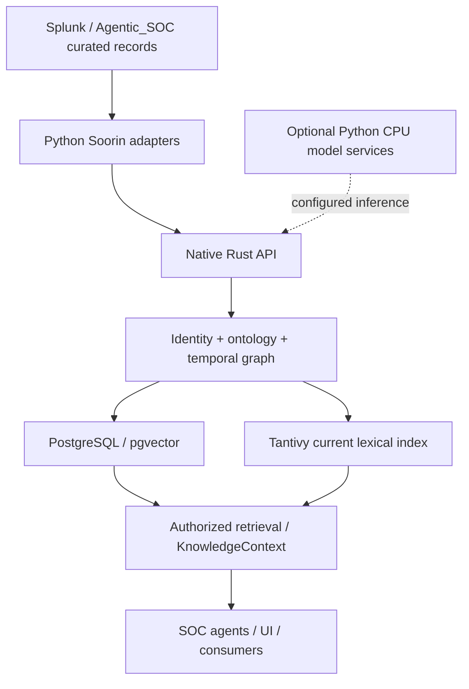

<div align="center">


# Soorin Temporal Knowledge Graph

**Evidence, identity and history for security operations.**

[Architecture](docs/soorin/PRODUCTION_ARCHITECTURE.md) · [Deployment](docs/soorin/PRODUCTION_DEPLOYMENT.md) · [Integration](docs/soorin/AGENTIC_SOC_INTEGRATION_V1.md) · [Acceptance](docs/soorin/FINAL_ACCEPTANCE_REPORT.md) · [Documentation](docs/soorin/README.md)

</div>

Soorin TKG is an independent enterprise-oriented knowledge service for security
teams and their agents. It connects curated alerts, source events, assets, users,
cases and evidence while retaining what was true and what the system knew at a
particular time. It builds on Utopia's graph, retrieval and governance foundation.

> **Qualification status:** implementation and lightweight regression checks are
> available. Runtime qualification and production approval remain separate gates.
> See the [current hardening report](docs/soorin/PREBUILD_HARDENING_REPORT.md) for
> exact evidence and integration status.

## Why Soorin

Security investigations need more than a current document or a vector match.
Soorin keeps source identities distinct, makes provenance inspectable and retains
history across revisions. Engineers can ingest repeatable events; analysts can
inspect facts and evidence; read-only consumers can request bounded, authorized
context without gaining remediation authority.

## Capabilities

- Native authenticated SOC ingestion with durable receipts and recoverable jobs.
- Tenant/source/network boundaries, persistent authority registry, aliases and
  conflict quarantine; names and vector similarity are not merge authority.
- A reviewed SOC ontology with 17 entity types and 15 relation types, deterministic
  type/phrase alignment and evidence-backed typed materialization.
- Valid-time and knowledge-time graph queries with historical evidence filtering.
- Tantivy lexical search, pgvector embeddings, RRF fusion and optional native reranking.
- KnowledgeContext v2 and exact extractive citations for read-only agent integration.
- Optional pinned CPU embedding, reranker and review-only NER services.
- Deployment-owned model egress policy and Privacy Gateway transport.
- React operator interfaces for Graph, Search, Ask, Library, Review, Ontology,
  Mappings and Settings.

## System architecture

The diagram describes implemented interfaces. External connectors and optional
model services still require deployment-specific runtime qualification.



## System components

| Component | Responsibility |
|---|---|
| Rust API and workers | Authentication, ingestion, jobs, identity access, alignment, graph persistence, retrieval and protected model transport |
| PostgreSQL / pgvector | Durable KB state, history, provenance, vectors, jobs, settings and audit |
| Tantivy | Rebuildable current lexical index; historical lexical retrieval uses PostgreSQL |
| Python adapters and contracts | SOC normalization, canonical events, conservative identity policy and integration clients |
| Optional Python model services | Pinned local embedding/reranker/NER APIs; independent profiles |
| React / TypeScript UI | Operator workflows and inspection |
| Graphify | Local code-analysis aid; separate from live knowledge graph data |

## Native SOC ingestion

```mermaid
flowchart LR
    S[Source] --> N[Normalization]
    N --> C[Event v1 / checksum v3]
    C --> A[Source-token authentication]
    A --> R[Durable receipt]
    R --> I[Identity registry]
    I --> D[Statements pipeline]
    D --> O[Ontology alignment]
    O --> T[Typed graph]
    T --> Q[Retrieval / context]
```



A successful HTTP admission records a receipt, not instant graph completion.
`bound` requires identity/document completion and recognized typed SOC relations.
Invalid signatures fail admission; incompatible older queued events are preserved
in quarantine. Exact replay reuses the receipt and stable document identity.
See [Integration v1](docs/soorin/AGENTIC_SOC_INTEGRATION_V1.md).

## Identity and time

SecurityAlert, SplunkNotable, SecurityEvent, DetectionRule, Case and Decision are
separate identities. Correlation does not merge them. Canonical authority and
immutable KB source bindings protect native source scope; provisional aliases
remain review candidates. Established v1 provisional keys deliberately retain
compatibility limits documented in [Identity](docs/soorin/ENTITY_RESOLUTION.md).

`at` selects valid/world time; `as_of` selects knowledge/record time. Occurrence
time stays stable across updates. Explicit source update time can advance a
revision; delivery time and opaque revision IDs cannot. Historical requests do
not fabricate later citations. See [Temporal model](docs/soorin/TEMPORAL_MODEL.md).

## Retrieval and GraphRAG foundations

Native retrieval combines lexical and compatible dense candidates, authorizes and
reloads them, optionally reranks bounded batches, and returns final results.
Embeddings carry model fingerprints; incompatible/unknown vectors are excluded.
Historical lexical behavior differs from current Tantivy tokenization and ranking.

KnowledgeContext v2 returns ledger facts, evidence versions, conflicts, bounds and
limitations. Truncation or missing citations produce partial results. Exact
extractive claim validation does not certify arbitrary generated text or security
conclusions. See [Retrieval and reranking](docs/soorin/RETRIEVAL_AND_RERANKING.md).

## Integration boundaries

Splunk/Agentic_SOC records enter through versioned Python normalization and native
source-token ingestion. The provider-independent client supports bounded retries,
redacted errors and separate reader credentials. Agentic_SOC remains optional;
Soorin has its own users, KBs, database, UI and jobs.

Recon, Forensic, ReportWriter, AutoTriage, Copilot and Responder can consume
read-only context. No automated containment or SOC write-back is enabled.
[Agent compatibility](docs/soorin/FUTURE_AGENT_COMPATIBILITY.md) preserves the five
AutoTriage verdicts as attributed decisions rather than verified observations.

## Deployment architecture

Use the independent [production deployment](docs/soorin/PRODUCTION_DEPLOYMENT.md)
with `docker-compose.production.yml` and
`soorin/config/production.env.example`. It requires explicit qualified Soorin and
PostgreSQL image references, separate DB roles, secret injection and a TLS proxy.
The optional model overlay publishes no model ports. No published production
Soorin image is assumed by the template.

The generic upstream-image Compose remains a compatibility path. Applied
migrations are immutable; the upstream 0111 collision requires a separately
reviewed [roll-forward reconciliation](docs/soorin/upstream-sync.md).

## Development quick start

Begin with [Pre-build validation](docs/soorin/PREBUILD_VALIDATION.md) and
[Local development](docs/soorin/LOCAL_DEVELOPMENT.md). Preserve existing labs,
volumes and caches; 1516/1517 and 2516/2517 may already be occupied.

```bash
timeout 30s python3 -m compileall -q soorin
timeout 45s python3 -m unittest discover -s soorin/tests -p 'test_*.py'
timeout 15s python3 -m unittest discover -s soorin/tests/mock_splunk/tests
```

Use [Build and test handoff](docs/soorin/BUILD_AND_TEST_HANDOFF.md) for the next
controlled Rust/image/database/runtime qualification phase.

## Model configuration

BGE-M3, BGE reranker and cybersecurity NER use pinned revisions and separate
profiles. `download`, `verify-artifacts` and `serve` have distinct responsibilities.
Workspace settings configure native model clients; Python evaluation variables
cannot activate them. NER is review-only. Real loading, inference and resource
acceptance remain separate from mock tests.
See [Model configuration](docs/soorin/MODEL_CONFIGURATION.md) and
[Artifact lifecycle](docs/soorin/MODEL_ARTIFACT_MANAGEMENT.md).

## Security and privacy

Source tokens authorize ingestion; KB roles authorize readers/operators; immutable
tenant/source bindings protect admission scope. Raw vendor payloads and excerpts
are excluded by default. Structural minimization is not semantic DLP.

External model requests require approved protected transport; redirects and raw
provider fallback are blocked. Private model APIs depend on trusted network
placement. See [Security boundaries](docs/soorin/SECURITY_BOUNDARIES.md) and
[Outbound privacy](docs/soorin/OUTBOUND_PRIVACY.md).

## Testing and acceptance

| Status | Meaning |
|---|---|
| Implemented | Source and versioned interfaces exist |
| Tested | Named static/mock/unit checks passed for a recorded commit |
| Runtime-qualified | Exact image passed controlled DB/model/integration acceptance; still pending |
| Production-approved | Deployment, security, rollback and operator gates passed; not granted |
| Planned | Future work explicitly outside implemented behavior |

See [current hardening evidence](docs/soorin/PREBUILD_HARDENING_REPORT.md),
[engineering acceptance](docs/soorin/FINAL_ACCEPTANCE_REPORT.md), and
[gap register](docs/soorin/ENGINEERING_GAP_REGISTER.md). A previous CI result does
not validate a new commit. No real model or full application build is part of the
current pre-build hardening pass.

## Documentation and contribution

The [documentation index](docs/soorin/README.md) links current contracts and
operational procedures. Historical reports remain labeled and preserved.
Contributions should keep contracts/history stable, use isolated synthetic tests,
preserve tenant/evidence boundaries and create small reviewable commits. Do not
commit credentials, model weights, databases or local Graphify data.

## Upstream demonstration

[Watch the original Utopia demonstration](https://github.com/user-attachments/assets/aa226443-75de-437e-bd80-88e592ed8457),
created for the upstream Utopia project by its contributors. It illustrates the
upstream foundation and is **not a Soorin-specific demonstration**. The link is
preserved from [README.upstream.md](README.upstream.md); no video was copied or
redistributed. Direct media availability could not be verified from this environment.
A Soorin-specific recording is planned after the next successful qualification build.

## License and attribution

The Utopia-derived implementation is distributed under the bundled
[Apache-2.0 license](LICENSE). Preserve upstream copyright and license notices.
The original documentation remains in [README.upstream.md](README.upstream.md).
The company artwork is a supplied Soorin asset; software licensing does not imply
redistribution rights for independently hosted demonstration footage.

## V1 baseline update

For the latest V1 baseline scope, read [Baseline hardening](docs/soorin/V1_BASELINE_HARDENING.md), [manual SOC preview](docs/soorin/MANUAL_SOC_INGESTION.md) and [agent contracts](docs/soorin/AGENT_TOOL_CONTRACTS.md). Real model inference and live integration remain NOT RUN.
