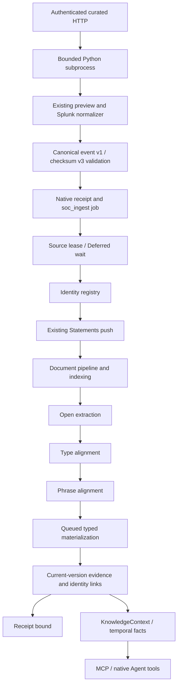

# Continuation dependency review — 2026-11-15

Graphify was queried before edits and refreshed with the installed AST-only
`graphify update .`. Generated caches are ignored and not committed. Critical
edges below were verified in source; the graph is navigation evidence only.

| Call chain | Verified source / consequence |
|---|---|
| `soc_curated → python3 -S → http_adapter → preview → normalize_llm_payload → soc_ingestion::ingest` | One implementation of normalization/identity/checksum; two subprocess slots, 10-second deadline, kill-on-drop; source auth and binding precede normalization |
| `soc_ingestion::process → process_locked → handle_statements_push → process_document → extract_document` | Lease owner fencing and 90-second handler limit within 120-second lease; temporary dependencies defer 15 seconds |
| `extraction_open → align_types → align_phrases → soc_alignment::phrases → materialize_typed` | Existing bindings still deliver work. Coalesce queued work atomically; a running snapshot never suppresses its successor |
| `run_worker → JobOutcome → persist_with_retry → persist_outcome` | Persist the same computed outcome after transient DB write failure; original locked_at fences stale results; no re-execution just to acknowledge success |
| `ontology_index / pipeline / name and query embedding → LlmClient::embed → CPU HTTP` | CPU wire/window policy applies only to exact pinned BGE model identity; generic provider behavior is preserved |
| `retrieval → reranker → shared CPU gate` | One heavy inference, four waiters, bounded handler threads; retrieval execution does not prove relevance |
| `KnowledgeContext → stored facts/evidence/known-as-of → MCP/tools/chat` | Existing read authorization, temporal queries, citations and budgets remain the production mechanisms; Python retrieval is evaluation only |

Direct inference origins require deployment trust. External protected calls use
workspace-to-tenant Privacy Gateway mapping and approved provider origins; a
privacy failure never authorizes direct-provider fallback. Source routing and
identity authority are separate from model similarity or NER proposals.
