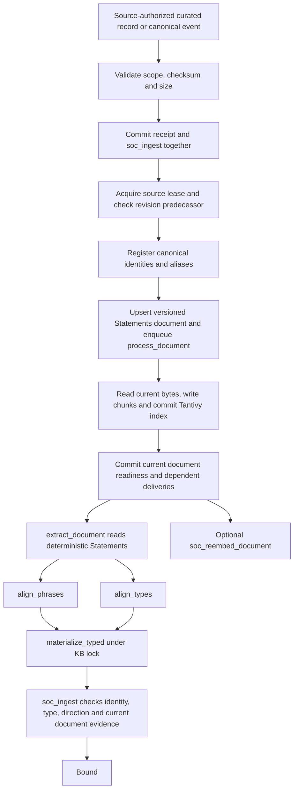

# SOC ingestion reliability investigation

Baseline 506cbb40, 2026-11-21. The incident totals describe 863 receipts and 1,382 failed jobs. The latest 100 receipts are a sample. The source and job records for receipt 01a1edda-d49e-7f32-aa84-a65d99d4bf4e on Server 55 were unavailable locally.

| Symptom and entry | Responsible worker / immediate error | Dependency and evidence | Severity, correction and regression |
|---|---|---|---|
| Submitted receipt, failed on attempt one after source admission | soc_ingest / soc_document_failed | process_locked converts any inactive failed document or graph into Terminal. jobs::JobOutcome immediately ends Terminal claims. The originating provider for job 6934 is unknown. | High. Persist child outcome class and distinguish repair from permanent rejection. Exercise legacy unknown failure, explicit repair, and eventual binding. |
| Configured embeddings prevent structured ingestion during an outage | process_document / provider error | pipeline::run calls embed_pending before set_ready and extract_document. Non-deferred errors mark the document failed. Deterministic Statements extraction already works without embeddings. | High. Commit lexical readiness, extraction and optional enrichment delivery together for the current document. Test with unavailable provider and later backfill. |
| 429 or temporary outage | document or ontology embedding | ModelGates uses deployment default 10 unless overridden. CPU runtime advertises one active and four queued. Caller-level ontology batch 64 is split into <=16 wire inputs for the pinned BGE model by LlmClient::embed. No evidence that this model sends a 64-input wire request. | High for saturation. Apply provider-aware background concurrency, bounded deferral and configurable batch limits. Verify existing CPU wire tests. |
| name_not_in_text | extract_document / open extraction drop | span_in_quote compares normalized text literally. Serialized JSON can double backslashes. A drop is recorded independently of receipt job status. The incident values alone do not prove a false drop. | Medium. Decode valid JSON string values for matching. Test against actual escaped chunk values and absent names. |
| Many waiting jobs per source | soc_ingest / source lease contention | One lease per source, 120s expiry, 90s handler timeout, 15s deferred polls. SKIP LOCKED claims due jobs. Deferred restores the attempt within a 1h window. Separate corrections of a record must execute in order. | Preserve lease and revision rules. Make waits observable and retain bounded retry budgets. |

## Delivery and recovery

Each arrow between queued jobs is a durable dependency, not a guarantee of execution order. The receipt worker revisits prerequisites. Alignment and enrichment can run independently. An accepted source revision can bind while dense indexing is pending. Dense writes still require a live chunk and the current workspace model identity. A superseded or deleted document cannot pass the new hash-guarded readiness update. BM25 indexing occurs before the transaction that marks a structured document ready. An interrupted worker can rebuild the lexical index from durable chunks.

| Delivery | Prerequisite and failure handling |
|---|---|
| `soc_ingest` | A source lease serializes registration/revision work. Conflicting identity claims or late/ambiguous source clocks enter review. Confirmed terminal child failure stops the parent. Missing or legacy-unclassified child outcomes remain eligible for explicit repair. |
| `process_document` | Reads and chunks a live document. An unreadable input can be terminal. After lexical indexing, the Statements path commits readiness, extraction (when enabled) and configured enrichment in one transaction. |
| `extract_document` | Requires current chunks and the applicable source policy. Structured statements supply typed source data. Open extraction can record individual evidence drops or document-level incomplete extraction. A drop counter alone cannot diagnose a failed receipt. |
| `align_types`, `align_phrases` | KB-wide jobs match type and phrase signatures. A human rejection remains binding. Neither queue order nor success of only one job proves graph readiness. |
| `materialize_typed` | Recomputes under a KB lock. A competing owner defers. The queue compares the logical payload without its internal deferral timestamp. Fresh delivery after a running job took its snapshot is allowed. |
| `soc_reembed_document` | Fills missing vectors using the active model configuration and live chunk identifiers. Its retry budget and status are independent of evidence binding. |
| `resolve_time`, inference and review | Other deliveries can coexist in the same KB. A count from `jobs/failed` includes unrelated jobs. Investigate by job ID, kind and receipt dependency. |

Worker acknowledgement checks the original `locked_at` and retries failed database writeback with bounded backoff. Startup requeues orphaned running jobs. This assumes the supported single application worker process. Deploying multiple active application replicas would require worker-owner heartbeats and scoped orphan recovery. The per-source lease and per-KB materialization lock live in PostgreSQL.

## Operator settings

| Setting | Default and operation |
|---|---|
| Workers | New CPU-first deployments default to **8** (migration 10007), adjustable from 1 to 256 via the authenticated administrator `PUT /api/v1/admin/deployment`. Migration 10007 converts rows equal to the historic 64 default to 8; other explicit values remain unchanged. An operator who deliberately selected exactly 64 must restore it through the authenticated Admin API after upgrading. With an 8-connection DB pool and one CPU model inference slot, start at 8 and keep the pinned embedding model concurrency limit at 1. Monitor queue age, pool acquisition, retries and p95 search latency. Because jobs awaiting model permits occupy worker slots, this conservative cap can delay lightweight jobs during heavy inference; dedicated job-class queues and early admission control are required before scale-out. |
| Source lease | One owner per source, 120 s expiry, 90 s processing deadline. The queue skips SOC deliveries with a live source lease. A claim that races with lease acquisition still checks ownership. Dependency checks normally retry after 15 s. |
| Model concurrency | Background permits are per application process and keyed by endpoint and model. Explicit `model_limit` on the deployment API wins. The pinned CPU BGE embedding model defaults to one. Other models use the deployment default (10). Interactive search bypasses background permits. The CPU service still enforces its shared inference limit across roles. |
| CPU request queue | One active inference across embedding, reranking and NER, with 0–4 waiting requests (`SOORIN_MODEL_QUEUE_CAPACITY`, default 4). Queue acquisition timeout is `SOORIN_MODEL_QUEUE_TIMEOUT_SECONDS`, default 6, maximum 120. Overflow returns HTTP 429. Read `/ready` for the configured queue capacity. |
| Wire batches | `UTOPIA_EMBED_BATCH_LIMITS` accepts a JSON object keyed by exact model name, e.g. `{"BAAI/bge-m3@5617a9f61b028005a4858fdac845db406aefb181":8}`. Generic providers keep their caller batches by default. The pinned CPU model always caps requests at 16 windows, regardless of the larger logical ontology batch. |
| Provider deadlines | Direct model HTTP connect timeout 10 s, read inactivity timeout 300 s. Override the latter per model with `UTOPIA_MODEL_READ_SECONDS`, e.g. `{"BAAI/bge-m3@5617a9f61b028005a4858fdac845db406aefb181":90}`. Values are 1–3600 s. Restart the application after environment changes. A separate privacy gateway controls its own exchange deadline. |
| Retry budgets | SOC admission schedules five attempts. Ordinary deliveries default to three. Typed 429, temporary gateway failures and interrupted transports defer for Retry-After or 15 s, bounded to 1–3600 s. Waiting restores the claim attempt within a one-hour deferral window. Exhaustion returns to the ordinary finite budget and quadratic backoff (30 s × attempts²). Read inactivity timeouts use the ordinary budget. |
| Search under load | One foreground search can still encounter provider saturation. Inspect `retrieval.dense_executed`, `lexical_method`, `reranker_status` and results. A successful lexical fallback is distinguishable from vector search. |

For a stalled receipt, fetch its KB-scoped diagnostic detail. Match the current document ID/version and stage to the corresponding child job. Check the parent separately. A failed child with an unknown historical class warrants inspection. After repairing a recoverable dependency, a KB administrator posts to `/api/v1/kbs/{kb}/knowledge/receipts/{id}/retry`. That transaction requeues the failed child if needed and reuses an active parent or creates a replacement. Resolve a failed predecessor before retrying a later revision. A completed or quarantined receipt cannot be retried through this endpoint. Full job error chains remain internal. The public job status exposes a bounded class.

## Producer and investigation clients

Use the per-source ingest token for preview and curated ingestion under `/api/v1/sources/{source_id}/soc/`, or for a canonical event at `/api/v1/sources/{source_id}/knowledge-events`. Configure the KB tenant, system and source-instance binding first. Replay the identical event after an uncertain admission response and retain the returned receipt ID. Use a KB administrator session for receipt listing, diagnostics and explicit retry. The additive `delivery_state` distinguishes accepted, queued, running, waiting_for_dependency, failed_recoverable, terminal_failure, quarantined and bound. Existing `status` and `failure_code` remain available.

Resolve an alert through its exact authority and identifier within tenant, KB, source system and instance. Continue to KnowledgeContext on an unambiguous resolution and retain source document/version, evidence references, valid time and record time. Use scoped read credentials for search and supported read-only MCP tools. The Python client/adapter or external agent must persist the receipt, back off while polling, handle ambiguous and review outcomes, distinguish lexical fallback, and preserve citations. Source writes and administrator receipt operations require their respective REST credentials. A live external Agentic_SOC connector remains a separate integration.

The bounded load driver uses two admission clients, one transaction per record, a unique new synthetic KB per size and one idempotent replay. Admission was faster than binding in both initial completed batches. A bulk HTTP endpoint would not address the measured wait. From the isolated application network run `SOORIN_ISOLATED_LOAD=1 python3 -m soorin.e2e.reliability_load --port 31261 --report /tmp/load.json`. Polling has a deadline and safe retries for transient timeouts. The report contains synthetic identifiers, counts and elapsed times.

## Final Server 55 release candidate

One PostgreSQL queue owner claims individual deliveries. Claim timestamps fence acknowledgments. Source leases and predecessor checks order revisions. Pending child work can defer without consuming attempts during the bounded window. Keep eight workers as a starting measurement. The claim query permits at most two running SOC reembedding jobs, or one when worker capacity is one or two. Remaining slots can execute graph and receipt work. The source-specific admission lock also serializes guarded dataset ownership checks before insert. Identical canonical deliveries reuse receipts. Only explicitly guarded synthetic admissions compare the optional run UUID. Ordinary producer requests retain their existing behavior.

Graph binding still requires the current ready document, reviewed type/authority links and version-matched relation evidence. Missing, zero, wrong-dimension and obsolete-fingerprint active vectors are independently repairable through reembedding. Backfill can revisit a running document. The write predicate rechecks fingerprint, live chunks and deletion in a transaction. Query-time pgvector configuration uses the already-held transaction connection, including on the first capability probe.

Search admits one cross-encoder request at a time per process. Other simultaneous searches follow their configured fallback policy. Requests use POST /rerank with model, query and texts. 1–16 texts fit within 300,000 serialized JSON bytes. One transient 429/503 retry is shared across all batches. Numeric Retry-After delays up to five seconds are honored. Other delays and validation errors return directly to policy. Each response must supply one finite score per batch-local index. A common deadline covers retries, response reads and aggregation. Score ties preserve authorized RRF order. Defaults are a 16-candidate window, eight per batch, 18 seconds per POST and 30 seconds overall. Query embedding has a separate 30-second budget. The default Search retrieval budget is 75 seconds after access checks. Per-request settings are deployment environment variables in the Compose app definition.

Legacy `candidate_count` and `score_type` retain their wire semantics. `unique_candidate_count`, `authorized_candidate_count` and `final_order` identify actual inputs and the ordering stage. The latest observed 48 raw hits and an eight-pair direct model check cannot identify the exact provider failure or deployed binary. Record the image ID, revision label, binary digest, sanitized failure category and elapsed time when repeating the full Search. The release procedure, metric definitions and operator gates are in [Server 55 production release](SERVER55_PRODUCTION_RELEASE.md).

The deterministic retrieval fixture v2 includes 14 documents, 3 judged queries, overlapping benign vocabulary and a foreign tenant. Using the offline Python evaluator, lexical, mock dense + RRF and mock reranked modes each measured Recall@5 1.00, Recall@10 1.00, MRR@10 0.750 and nDCG@10 0.810. Mock dense alone measured 0.667, 1.00, 0.556 and 0.662. Run `python3 -c 'from soorin.evaluation.retrieval_benchmark import quality_at_cutoffs; print(quality_at_cutoffs())'`. This fixture checks scoring and scope. Actual BGE ranking quality and load latency require server measurements.

Backfill identifies enrichment by document UUID across both historical payload shapes. A queued delivery suppresses a duplicate. A running job can have one queued successor, which is eligible after the current job exits. This preserves delivery when the document changes after a worker reads its chunks. The legacy `queued` counter reports eligible documents in the selected batch, as does `eligible_documents`. `new_jobs` counts inserts, and `already_pending` counts eligible documents with a queued delivery.

## Operator verification

Watch the JSON progress emitted by `verify`, including receipt counts, elapsed
and remaining time, scheduler counts and bounded blocker classes. Queue depth,
running jobs, and pending embedding jobs are deployment-wide gauges. Receipt
binding counts still refer to the current run. The verifier writes phase state
to `verification-phases.json` and detailed measurements to the existing reports.
A timeout or Ctrl-C marks the active phase inconclusive and leaves its partial
evidence available. Later unstarted phases remain not tested. After resolving
a blocker, rerun `verify` with the same journal on the same deployment.
Re-verification performs reads. A new deployment needs a fresh manifest and
non-overlapping index range. Run `report` to read the stored verdict and phase
evidence. A missing isolation probe cannot pass the release gate.

Filter app traces for `soc.receipt_created`, `soc.materialization_started`,
`soc.materialization_failed`, `soc.receipt_bound`, and
`soc.embedding_completed` to follow an opaque receipt or document ID. Job
traces record queue delay, claim time, attempt, fenced outcome, and scheduled
retry delay. `job.recovered` summarizes queue startup recovery. Model telemetry
is described in [Retrieval and reranking](RETRIEVAL_AND_RERANKING.md).
