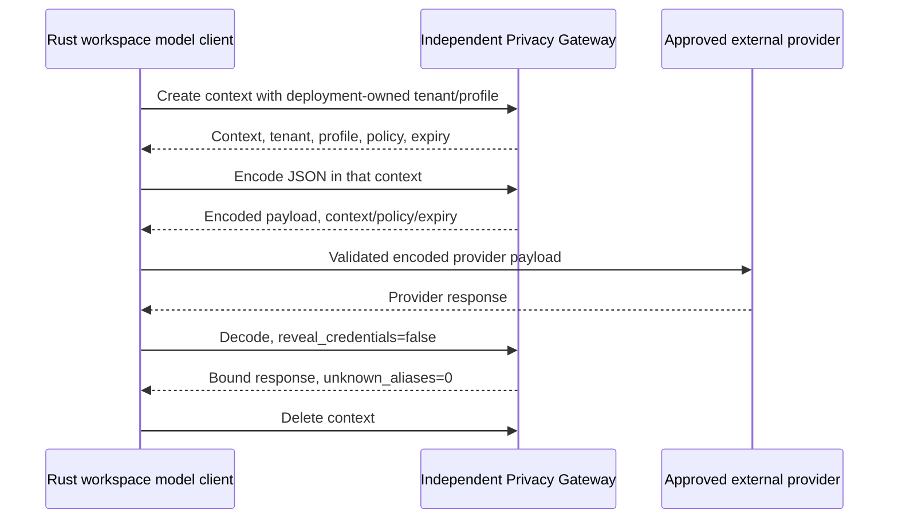

# Native model egress and Privacy Gateway

The deployment owns trust. Workspace administrators can configure model
settings but cannot add trusted origins or choose a different tenant mapping.
Unknown origins fail closed. No production exception derives trust from a
request boolean, a hostname suffix, or the word "localhost".

## Deployment configuration

`docker-compose.soorin-dev.yml` forwards these variables to the Rust process:

- UTOPIA_MODEL_TRUSTED_ORIGINS: exact scheme/host/port origins of internal
  inference services; defaults to embedding, reranker and NER on port 8080.
- UTOPIA_PRIVACY_GATEWAY_URL and UTOPIA_PRIVACY_GATEWAY_KEY: independent
  gateway REST endpoint and service credential.
- UTOPIA_PRIVACY_TENANT_MAP: JSON object mapping authorized workspace UUIDs to
  canonical gateway tenant UUIDs, established by the deployment operator.
- UTOPIA_PRIVACY_PROFILE: reviewed gateway profile, default agentic-soc-v1.
- UTOPIA_PRIVACY_PROVIDER_ORIGINS: exact approved external provider origins,
  e.g. https://api.deepseek.com.

Do not commit keys or tenant mappings containing organizational details.
Use an env file with restricted permissions or deployment secret storage.
Do not print resolved Compose configuration when secrets are populated.
UTOPIA_MODEL_TEST_MODE=1 is reserved for synthetic CI loopback mock servers;
it never grants access to external providers and must not be enabled in production.

## Protected Chat/tools/embeddings lifecycle

The Rust transport follows the published Agentic_SOC privacy-branch REST
contract. It validates canonical tenant UUID, context and profile binding,
policy version, unexpired context/encode metadata, response format, payload
presence, zero unknown aliases, and provider protocol shape. Model, roles,
tool names/IDs and nonstring parameters cannot change during encoding.
Redirects are disabled. Errors exclude gateway/provider response bodies.

Protected streaming requests use complete non-streaming responses internally,
then emit decoded content. This deliberately prevents partial alias restoration
across token fragments. Context cleanup runs on success/failure and on task
cancellation; gateway TTL remains the crash fallback. Gateway/provider failure
does not cause a direct-provider retry. Live gateway compatibility remains an
acceptance gate distinct from local mock tests.

Native shared clients cover ingestion extraction, model-assisted operations,
Chat, tools, query embeddings and document embeddings. Reranking, OCR, visual
OCR and transcription require trusted internal origins and disable redirects.
Binary audio/images are not sent through a text-tokenization gateway.
External OCR/transcription is blocked until a separately reviewed binary privacy
mechanism exists. Python SDK adapters have their own outbound policy and do not
configure native Rust trust.

## Protocol state and logs

DeepSeek reasoning_content is preserved only as private tool-continuation
protocol state. The Rig adapter carries it in an execution-local map, outside
UI history and tool content. Provider errors retain typed classification and
internal diagnostic fields while Display/Debug omit response text. Logs must
not include raw documents, source events, model prompts, API keys or decoded
gateway content.

The gateway remains responsible for detection, tokenization, policy semantics,
alias storage and encryption. Soorin does not implement a second tokenizer,
infer tenants from arbitrary request headers, or modify the gateway repository.

Release builds ignore `UTOPIA_MODEL_TEST_MODE`; the environment shortcut only
exists in debug/test builds for local mocks. Secure HTTP-client initialization
fails explicitly instead of falling back to default redirect/timeout behavior.
Production tenant mapping, network isolation and storage minimization are detailed
in [Security boundaries](SECURITY_BOUNDARIES.md). No real provider or gateway
request was made during this lightweight hardening pass.
