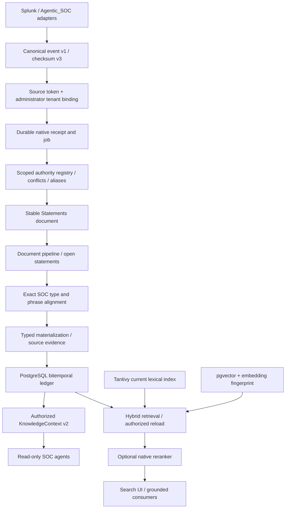

# Production architecture

Soorin is an independent Rust API, React UI, PostgreSQL/pgvector database and
persistent file/index service. Agentic_SOC and optional model services are not
startup dependencies. This is an engineering design; deployment acceptance is
pending. See [acceptance evidence](FINAL_ACCEPTANCE_REPORT.md).

Rust owns authentication, authorization, persistence, jobs, alignment,
materialization, retrieval and model transport. Python owns normalization,
canonical contracts, optional CPU service implementations, clients and evaluation.
PostgreSQL is authoritative; Tantivy is a rebuildable current lexical index.
Historical lexical recall uses PostgreSQL and has different tokenization/ranking.

## Audited runtime paths

| Boundary | Implementation / invariant |
|---|---|
| Normalization | `soorin/adapters/splunk/llm_payload_normalizer.py`; source IDs remain distinct; minimization precedes checksum creation |
| Admission | `api/soc_event_validation.rs`, `api/soc_ingestion.rs`; source bearer token, KB tenant binding, checksum validation before registration |
| Identity | `utopia-store/src/soorin_identity.rs`; KB/tenant/source/type/authority/scope tuple; conflict quarantine, no display-name merging |
| Delivery | Durable receipt/job, per-source expiring lease, Statements through existing document pipeline |
| Alignment | `soc_alignment.rs`, type/phrase handlers and store bindings; exact reviewed vocabulary; human decisions protected by SQL guards |
| Materialization | `materialize.rs`; `typed_fact_sources`, copied evidence/qualifiers, append-oriented fact history |
| Context | `api/soc_knowledge.rs`; tenant/KB authorization, record/world axes, evidence eligibility, bounded SQL and response metadata |
| Vectors | `soorin_embeddings.rs`, pipeline and `llm_util.rs`; fingerprint includes endpoint/model/dimension; writes recheck workspace settings |
| External models | Native LLM client → deployment origin policy → context/encode/provider/decode/cleanup gateway; binary OCR/transcription require trusted local origin |

Graphify's existing index was queried before the audit and its AST-only updater
was inspected and run with a 55-second deadline. The update produced 12,002 nodes,
31,819 edges and 600 communities at the final code checkpoint. Source inspection and SQL
references resolved missing graph detail; Graphify is not an execution proof or a
runtime dependency. No semantic extraction or model call was requested.

## Operational boundaries

Production Compose requires an explicit Soorin image; the generic upstream
Compose remains a compatibility/development path and is not the Soorin production
entry point. API exposure defaults to host loopback for a TLS reverse proxy.
Database and model networks are internal. Models have independent profiles and
read-only pinned caches. Runtime DB identity is distinct from migration identity;
the current application still retains migration credentials for vector-index
DDL. A future external migration runner must account for that dependency.

The Python evaluation stack is deliberately separate from native retrieval;
its scores do not prove native runtime ranking. The legacy Statements client
bypasses native receipt/identity admission and must not share a native source.
`KnowledgeContext` is deterministic graph lookup, not an LLM answer pipeline;
its model provenance explicitly says `usage=none`.
