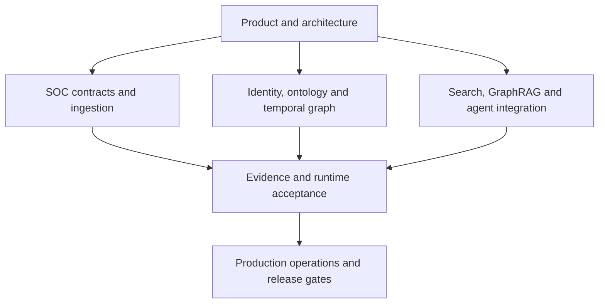
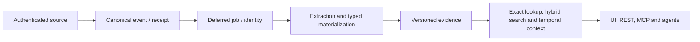

# Soorin TKG | Product & Engineering Documentation

**Soorin Temporal Knowledge Graph** is a standalone, evidence-first, bitemporal knowledge service for security operations. Its API and deployment contracts are implemented; a synthetic Server 55 image/model/ingestion/retrieval E2E has passed, while live agents and production acceptance remain pending. This documentation distinguishes *product capabilities*, *source-level validation*, *runtime acceptance* and *production approval*.

[Product overview](../../README.md) · [Current engineering report](FINAL_SOURCE_HARDENING_20261115.md) · [Next app-only build](APP_ONLY_REBUILD_20261115.md)

## Documentation map

| Audience / purpose | Start here |
|---|---|
| Product stakeholders and architects | [Product README](../../README.md) · [Production architecture](PRODUCTION_ARCHITECTURE.md) · [Knowledge architecture](SOC_KNOWLEDGE_ARCHITECTURE.md) |
| SOC integration developers | [Versioned producer mapping](PRODUCER_MAPPING_V1_20261115.md) · [Agentic_SOC integration](AGENTIC_SOC_INTEGRATION_V1.md) · [Curated and canonical ingestion](MANUAL_SOC_INGESTION.md) · [Curated HTTP OpenAPI](../../soorin/contracts/schemas/curated_http_v1.openapi.json) |
| Graph and data-model engineers | [Reviewed SOC ontology](SOC_ONTOLOGY.md) · [Identity and authority](ENTITY_RESOLUTION.md) · [Bitemporal semantics](TEMPORAL_MODEL.md) · [Source-level call paths](CONTINUATION_ARCHITECTURE.md) |
| Search and AI engineers | [Hybrid retrieval and GraphRAG](RETRIEVAL_AND_RERANKING.md) · [Agent tools](AGENT_TOOL_CONTRACTS.md) · [Model configuration](MODEL_CONFIGURATION.md) · [Model artifact lifecycle](MODEL_ARTIFACT_MANAGEMENT.md) · [Review-only cybersecurity NER](CPU_CYBER_NER.md) |
| Security and privacy reviewers | [Security boundaries](SECURITY_BOUNDARIES.md) · [Outbound privacy controls](OUTBOUND_PRIVACY.md) · [Agent compatibility](FUTURE_AGENT_COMPATIBILITY.md) |
| QA on an existing Workspace and KB | [Existing-KB login, synthetic fixtures and E2E runbook](EXISTING_KB_LOCAL_QA.md) |
| QA and SRE operators | [App-only upgrade, backup and acceptance](APP_ONLY_REBUILD_20261115.md) · [Later model and integration gates](NEXT_APPROVED_BUILD_20261115.md) · [Local development](LOCAL_DEVELOPMENT.md) · [Pre-build checks](PREBUILD_VALIDATION.md) · [Testing and evaluation](TESTING_AND_EVALUATION.md) · [Production deployment and rollback](PRODUCTION_DEPLOYMENT.md) |
| Engineering reviewers | [Final source report](FINAL_SOURCE_HARDENING_20261115.md) · [Earlier continuation report](CONTINUATION_HARDENING_REPORT.md) · [19-task acceptance matrix](CONTINUATION_TASK_MATRIX.md) · [Build handoff](BUILD_AND_TEST_HANDOFF.md) · [Engineering gap register](ENGINEERING_GAP_REGISTER.md) |

## Data lifecycle and verification

A valid receipt confirms **admission**, not completion. A `bound` receipt requires the expected typed entities, current-document-version evidence and authority links. Exact identity lookup uses source authority; similarity never automatically merges identities. Hybrid search may operate lexical-only when dense inference is unavailable, so verify retrieval metadata rather than inferring model execution from returned results.

The [native curated HTTP profile](MANUAL_SOC_INGESTION.md) supports a single documented Splunk/Agentic_SOC record envelope, not arbitrary vendor or batch input. Agentic_SOC remains a separate service and the producer source repository is a read-only integration reference.

## Current qualification status

| Gate | State |
|---|---|
| CI | Previous source baseline passed; verify current personal-fork CI fixes with a fresh run |
| Isolated Server 55 source-build QA | **Passed**: app, db, model container; 105 migrations; 17/15 ontology |
| Synthetic SOC admission and graph | **Passed**: 10/10 preview and bound receipts, canonical identity, typed evidence, exact/context and BM25 |
| CPU hybrid retrieval | **Functional PASS**: all 10 chunks embedded; dense + BM25 + native reranking completed in 21.04 s; performance remains open |
| MCP/PAT, Agentic_SOC, time revisions, privacy and hardened production | **Not accepted**: explicit follow-up gates required |

For a genuinely **fresh PostgreSQL test environment**, do not erase the historical QA database or model caches. The current E2E ownership guard allows a specifically named Compose project; creating a second project requires separately adapting/revalidating that guard, or run tests inside new synthetic KBs on an existing verified QA instance without calling the database fresh. Follow [the local handoff](NEXT_APPROVED_BUILD_20261115.md) and record exact Git/image hashes.

## Historical records and upstream heritage

The [earlier final acceptance](FINAL_ACCEPTANCE_REPORT.md), [pre-build hardening report](PREBUILD_HARDENING_REPORT.md), [Sprint 1 implementation](SPRINT1_IMPLEMENTATION_REPORT.md), [foundation gap review](SOC_FOUNDATION_GAP_ANALYSIS.md), [capability matrix](UTOPIA_CAPABILITY_MATRIX.md) and [baseline hardening](V1_BASELINE_HARDENING.md) are preserved as **historical checkpoints**. They do not override current source or qualify the newest image.

The project retains [upstream reconciliation notes](upstream-sync.md), [upstream documentation](../../README.upstream.md) and the bundled [Apache-2.0 license](../../LICENSE).

Never commit secrets, real SOC payloads, model weights, databases or Graphify caches. Keep schema/checksum compatibility, tenant source bindings, evidence histories and applied migration bytes intact.
