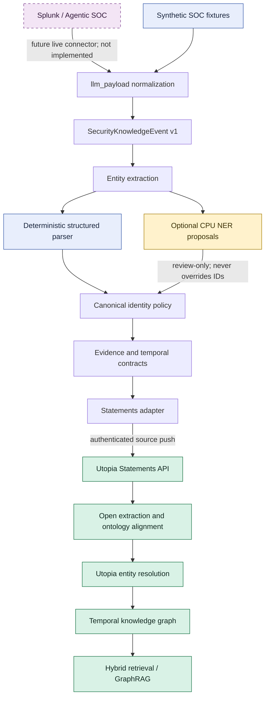
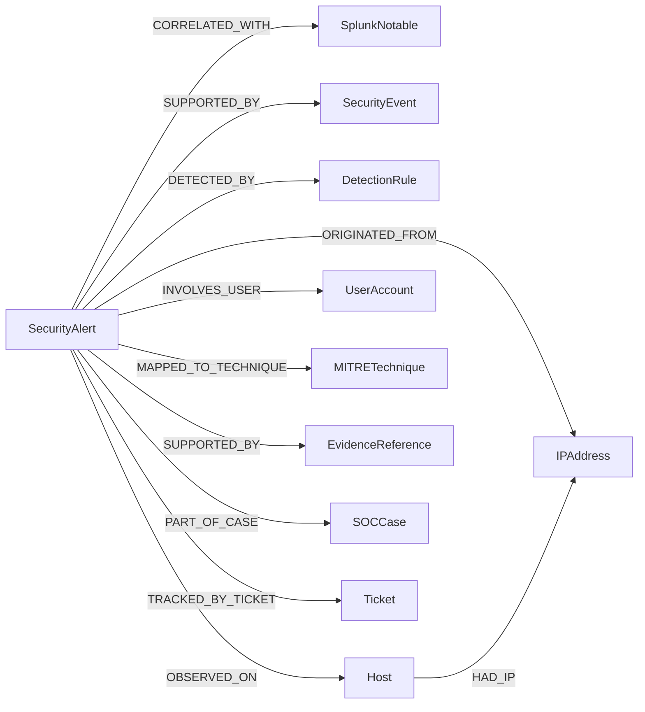
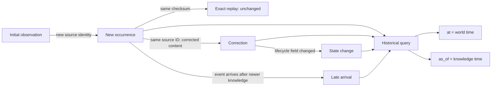
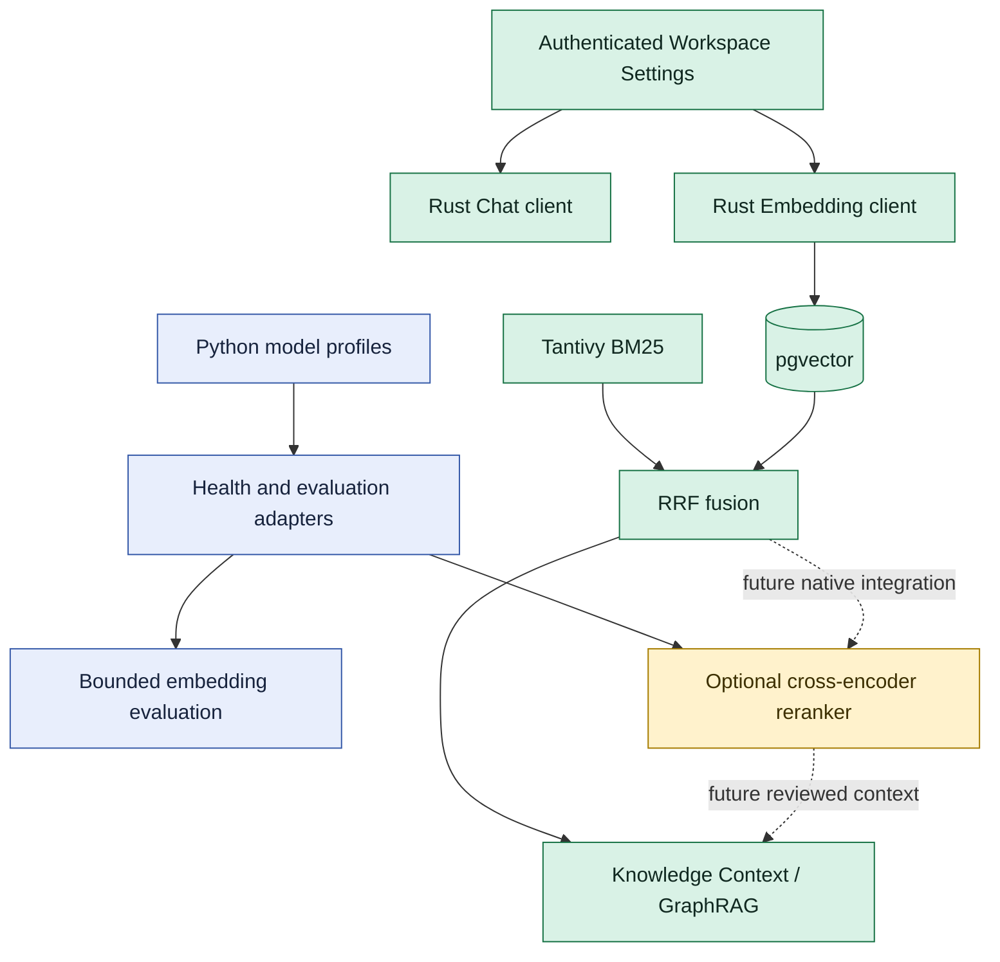
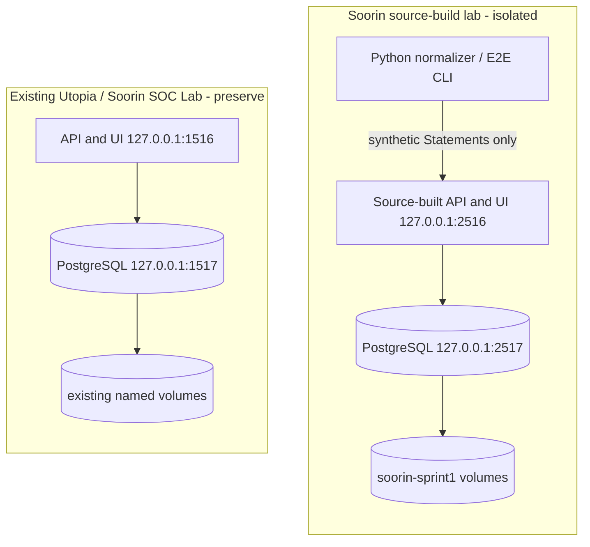

# Soorin SOC knowledge architecture

Soorin TKG is an independent knowledge service built on Utopia. Utopia owns
authenticated APIs, bitemporal graph persistence, ontology alignment, jobs,
search indexes, model settings, and the React UI. Soorin adds the SOC contract,
normalization, deterministic identity and extraction policies, Statements
projection, synthetic evaluation, and future Agentic SOC compatibility.

The diagrams distinguish runtime-active Utopia components from Python
development/evaluation components and future connections.

## 1. Complete SOC knowledge flow

Python modules are libraries and CLIs; no Python sidecar is deployed. The first
live validation runs the normalizer externally and pushes bounded Statements to
an isolated Utopia source.

## 2. Representative SOC ontology

The complete declaration contains 17 entity types and 15 relation types.
`SecurityAlert`, `SplunkNotable`, and `SecurityEvent` are separate identities;
correlation never means identity. Domain/range, temporal, inverse, and supported
cardinality fields are stored in Utopia. Provenance/confidence policies and
expected relation attributes also require adapter and acceptance-test checks;
the YAML declaration alone is not a universal database constraint.

## 3. Bitemporal lifecycle

World time says when a fact applied; knowledge time says when Utopia knew it.
Delivery and processing timestamps do not create source-content revisions.
Utopia owns ledger `recorded_at`/`invalidated_at`; the adapter maps source event
time to Statements and never fabricates ledger time. Exact replay still needs a
live `unchanged` observation in the isolated lab.

## 4. Models and retrieval

Workspace Settings are authoritative for live Rust Chat and Embedding. Python
`SOORIN_*` variables do not configure that runtime. The Rust path runs Tantivy
and pgvector in parallel and fuses bounded channel results with RRF. The Python
retrieval layer is an offline reference with bounded candidates/cache; the
reranker is not connected to native retrieval.

## 5. Isolated deployment

The projects share no database or persistent volume. Registration is disabled
after isolated bootstrap, ports are loopback-bound, and the E2E harness rejects
port `1516`. Safe shutdown omits `--volumes`.

## Ownership and trust boundaries

- Agentic SOC owns operational alert/case state until a versioned connector is
  implemented.
- Splunk and other source systems own source-observed events and identifiers.
- Soorin contracts define cross-system semantics, source identity, evidence,
  replay, and conservative canonical-key rules.
- Utopia owns authenticated materialization, ontology persistence, bitemporal
  facts, retrieval indexes, and operational UI.
- Model output is a review proposal. It cannot override authoritative source
  identity or analyst decisions.
- External Chat, Embedding, and Reranking share one fail-closed outbound policy.
  Sensitive production text requires a deployment-owned verifier attestation;
  a caller boolean is not proof of Privacy Gateway traversal.

The persistent identity registry exists behind migrations `0111` and `0112`,
but no active ingestion caller uses it. Foundation deliberately keeps it dormant
until Sprint 2 can activate registration, conflict handling, Statements render,
and Utopia entity binding in one authenticated transaction boundary.
